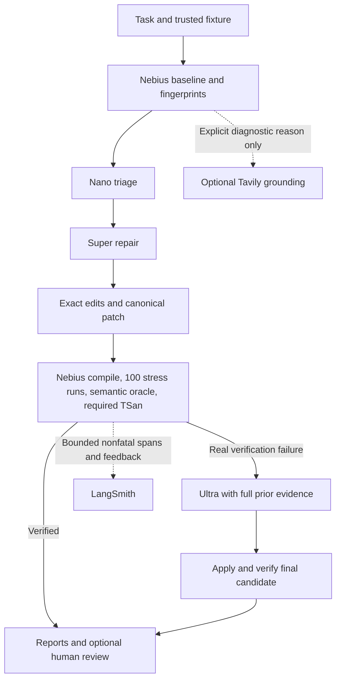

# Final integration and evaluation handoff

## Execution gate: ready for an explicitly authorized live benchmark

No paid model inference was performed during this final integration phase. `reports/final-benchmark.json`, `.csv`, and `.md` contain an honest `not_run` plan, not measured outcomes. The full paid benchmark has deliberately not started.

Implementation and remote validation are complete. The live run still depends on current connectivity, account quota, and configured model availability. Dollar cost is unknown without authoritative pricing. There is no local execution fallback.

## Implementation

The existing repository structure is retained. Adaptive execution now bounds Nano triage to one call, starts repair with Super, and calls Ultra only following actual candidate verification failure or an explicit escalation policy. Fixed Nano/Super/Ultra modes each allow one repair call by default. Automatic inference retries and format retries are disabled in the bounded path.

Exact source edits are converted to a canonical patch. Escalation retains the original task, original source, candidate source, Nano summary, prior patch/application evidence, compilation and verification results, and failure fingerprints. Invalid formatting, application rejection, and infrastructure failures are separate outcomes; they do not silently buy another model call.



The dashboard exposes live stages, actual campaign counts, model routing, patch and verification evidence, individual/combined technical metrics, and final benchmark reports. JSON APIs remain independent of the frontend. Unknown race counts and costs stay unknown rather than becoming zeros. False fixes count applied, schema-valid candidates that fail actual verification; infrastructure failures and rejected patches are excluded.

## Validation evidence

Final default suite: **255 passed, 8 deselected in 12.07 seconds**, executed inside Nebius Sandbox. Evidence: `reports/nebius-sandbox/20261003T173653Z/tests.json`. Tested project image: `agentkernel-project:20261003t173653z`. Eight opt-in tests were deselected; this is not a claim that every live integration was exercised.

Prepared Clang image: `agentkernel-clang:20261003122908`; readiness evidence: `reports/toolchain.json`. Clang and its normal runtime package were installed remotely without changing sandbox security controls. Five original race fixtures produced TSan findings, and their five known repaired versions passed instrumented checks. All ten known repairs passed their trusted semantic oracles; all ten no-op substitutions were rejected. JavaScript syntax validation also passed. Visual browser QA of the final dashboard was not completed.

Tests cover adaptive escalation and evidence carryover, no unnecessary Ultra call, bounded malformed-output handling, semantic failure and infrastructure distinction, false-fix classification, sanitizer parsing/readiness, conditional grounding, nonfatal tracing, reporting/redaction, budget math, dashboard API, and human-review eligibility. No fixture executable or pytest suite ran on the Windows host.

## Fixtures

Every fixture requests 100 verification stress executions and has a trusted semantic oracle. Race fixtures additionally require three Clang TSan executions per verification candidate.

| Fixture | Scenario | Semantic conditions | Required TSan |
|---|---|---|---|
| deadlock_001 | Opposite mutex acquisition | At least four successful locks and two joins | No |
| deadlock_002 | Bank transfer lock order | Balances 950/1050, total 2000, two transfers | No |
| deadlock_003 | Producer/consumer condition wait | Exactly one item 42 produced and consumed | No |
| deadlock_004 | Cache/logger nested locks | Cache and log value 42; expected read/log counts | No |
| deadlock_005 | Shutdown joins under state lock | Pending work drained; three completions and shutdown | No |
| race_001 | Shared counter | Positive workload; exact worker-times-workload total | Yes |
| race_002 | Concurrent bank balance | Balance preserved; all deposit/withdraw operations completed | Yes |
| race_003 | Cache initialization | Exactly one initialization; both readers observe 42 | Yes |
| race_004 | Shared queue | All 200 IDs consumed exactly once | Yes |
| race_005 | Shared configuration | Consistent version/inverse pairs; reads occur; final version 10000 | Yes |

`deadlock_001/main.c` remains unchanged from the historical run (SHA-256 `0de854b650e07a1dc7e9ef0baa0d8e1f86b0e352473054d3f5a57042027b48b2`). Other fixtures and their trusted checks are version 2. Historical version-1 results must not be presented as results for this updated suite.

## Safety and integration status

Fixture execution is remote-only. Credentials remain on the controller and are excluded from project uploads. Only allowlisted source files are editable; trusted oracle/support files and verification commands are not supplied by the model. Fresh compilation, execution deadlines, exact edit matching, canonical patches, secret redaction, loopback dashboard binding, and content-security restrictions remain in place. Started benchmark evidence cannot be overwritten for an automatic replay; use a new output directory for any deliberate subsequent experiment.

Nebius Sandbox: current remote suite and TSan probes succeeded. Token Factory: historical real Nano/Super/Ultra calls succeeded; the final integration suite used mock inference and made no new paid call. LangSmith: historical live traces were checked and confirmed (Nano 5 spans, Super 7, Ultra 8). New structured span and feedback behavior is tested with mocked HTTP, not newly demonstrated live; observer failures do not fail a repair job.

Tavily: disabled by default, at most one reason-gated lookup per job, with bounded official-document results and no source/credential payload. Its transport was mocked in tests; live Tavily was not exercised. Human review is limited to verified repairs. Toloka is an interface with an explicit pending adapter, not a claimed live integration. Human scores cannot override execution verification.

## Bounded benchmark budget

| Mode | Fixtures | Maximum paid calls |
|---|---:|---:|
| nano_only | 10 | 10 |
| super_only | 10 | 10 |
| ultra_only | 10 | 10 |
| adaptive | 10 | 30 |
| Total | 40 mode/fixture jobs | **60** |

At most 50 repair candidates: 5,000 stress executions + 50 semantic executions + 75 TSan verification executions = **5,125 verification executions**, plus **180 baseline executions**. Compilation invocations are not included in these execution totals. Early failures or successful Super verification reduce actual usage.

Per-call output caps are 768 tokens for triage and 2,048 for repair; the total maximum output allowance is **110,080 tokens**. Each request has a 48,000-byte input bound; bytes are not an exact token count. Retries: zero. Actual input/output tokens, latency, success, false fixes, semantic regressions, sanitizer outcomes, rejection categories, model calls, and token-per-verified-fix are reported from evidence. Cost remains null unless authoritative pricing provenance is available.

From the repository root, the exact gated command is:

```powershell
.\.venv\Scripts\python.exe -m agentkernel.concurrency.final_benchmark --fixtures benchmarks --output reports --env-file .env --sandbox-image agentkernel-clang:20261003122908 --live
```

**Do not execute until the full paid comparison is authorized.** Omitting `--live` only writes the plan. Current readiness does not guarantee future network availability or quota. Model catalog checks precede inference; unavailable models are not replaced silently.

## Limitations and historical result

A finite 100-run campaign and semantic oracle are evidence, not a proof of correctness, fairness, or race freedom. These small fixtures cannot establish production repair quality. The semantic oracles check declared invariants, not full adversarial equivalence. Unknown pricing prevents a trustworthy dollar forecast. Cloud snapshot retention follows the service's lifecycle; snapshots were not automatically deleted.

The earlier single-fixture comparison used 10,603 total tokens: Nano returned incomplete output, Super's applied patch failed all 100 verification runs, and Ultra passed 100/100. This is historical evidence for one version-1 fixture, not a ranking across the updated ten-fixture benchmark. See `reports/dashboard/3c1104de-f8ca-4af9-83a5-c4598eacfc25.json`.

## Three-minute judge demo

1. **0:00–0:35:** Open the dashboard. Explain the concurrency repair problem and remote-only execution; show the ten fixture definitions and declared invariants.
2. **0:35–1:15:** Show the historical deadlock comparison with its version-1 label: incomplete Nano output, Super's failed verification, Ultra's 100/100 outcome. Open actual patch and campaign evidence.
3. **1:15–2:00:** Explain the new adaptive route: Nano triage, Super repair, verification, conditional Ultra. Show the code/API evidence and the 255-test remote report, including semantic no-op rejection and TSan checks. Clearly distinguish these mocked-inference tests from live model results.
4. **2:00–2:35:** Show the final report's `not_run` status, per-model/combined metric fields, and the 60-call/5,125-verification ceiling. Do not click a paid launch during this evidence-only demo.
5. **2:35–3:00:** Show historical confirmed LangSmith traces and explain bounded grounding, pending human review integration, and limitations. End with the explicit live evaluation gate.
