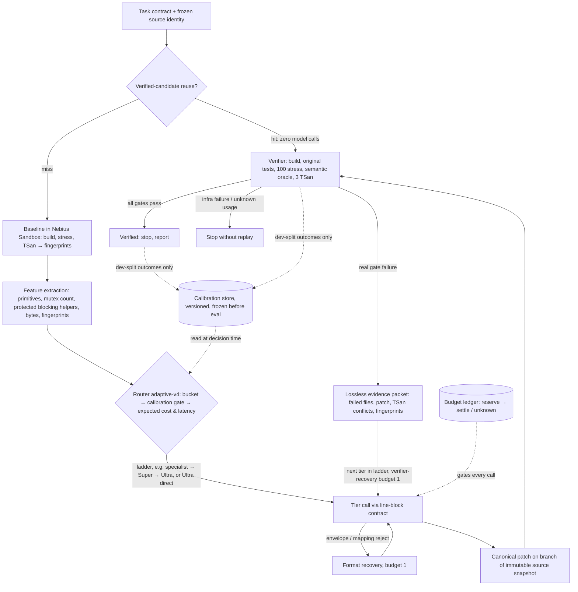

# ADR-0001: Adaptive architecture for the AgentKernel repair kernel

**Status:** Accepted (implemented and run live, 30 October 2026)
**Date:** 2026-10-30
**Deciders:** Project owner (AgentKernel); hackathon submission owner
**Context window:** Nebius × NVIDIA Global AI Hackathon, track *Coding and Agentic Engineering*. Submission deadline 30 Oct 2026, 22:30 IST (per `SUBMISSION.md`).

## Context

AgentKernel turns a model's repair proposal for a C/pthreads program into an experiment. The kernel builds the candidate in Nebius Sandbox, runs the original tests, 100 stress runs, a protected semantic oracle and 3 ThreadSanitizer runs. It accepts the candidate only if every gate passes. The hackathon requires an NVIDIA open model served on Nebius. Here that means Nemotron Super and Ultra through Token Factory, with an optional local Qwen LoRA specialist trained on the RTX GPU.

"Adaptive" here means deciding **which model to pay for, in what order, with what evidence**, so that cost and latency per *independently verified* repair go down without losing coverage. The repo has tried three answers so far.

| Generation | Route | Evidence | Verdict |
| --- | --- | --- | --- |
| v1 (`concurrency/`) | Nano triage → Super → Ultra | Historical, v1 fixtures | Nano's structured output was unreliable; a paid triage call that confidence could not justify |
| v2 (Sites agent) | Local specialist → Super → Ultra | 2-case holdout: 1/2, 13,304 tokens vs 1,041 for specialist alone | Same verified count as the specialist alone, roughly 13× the tokens |
| v3 (`adaptive_v3.py`) | Super → Ultra, fixed ladder | `reports/cloud-comparison/20261029T170003Z`, 8 cases | **6/8 verified, but 29% more expensive and 7% slower than Ultra-only (6/8).** Super verified 0/8, so every case escalated. |

The v4 diagnosis (`reports/adaptive-v4/20261030T115040Z/diagnosis.json`) traces Super's 0/8 mainly to **the response contract, not the model**:

- 15 of 16 Super replies rewrote the unchanged `#include "state.h"` line.
- Under the strict `json_schema` grammar, the raw `"` closed the JSON string. That produced 5 truncations at 39 tokens.
- Other replacements shifted later line numbers, producing 5 line-mapping rejects.
- Fallbacks received only outcome summaries, never the failed candidate or the TSan stacks.

These forces shape the decision:

1. **Verification is the only oracle.** No route may accept a candidate on model confidence, a classifier, or majority pass.
2. **The data is tiny.** There are 8 development-seen cases plus a few holdouts. Any learned router would be overfit theatre.
3. **Spending is capped.** The delegated pilot cap is $0.50 / 16 calls, and the ledger shows $0.2234 committed. Unknown usage must stop a route, not trigger a retry.
4. **The deadline is hours away.** Anything that is not already implemented and offline-tested is post-submission work.
5. **Judges reward honest, measured claims.** The project's credibility rests on never overstating results.

## Decision

Adopt an **evidence-gated, cost-aware deterministic router** (the v4 design) as the kernel's adaptive layer. Structure it as five layers with one feedback loop:

### Layer responsibilities

| Layer | Owns | Implementation | Invariant |
| --- | --- | --- | --- |
| **1. Contract** | Model I/O: `@@ REPLACE file a-b … @@ END` plain-text blocks, with source identity as sha256 of exact bytes | `adaptive_v4_core.parse_blocks`, `v4_messages` | Reject, never repair. No JSON grammar, so C quotes survive byte-exact. |
| **2. Router** | Choosing the tier ladder for each task | `route_features`, `bucket_of`, `decide_route` | Deterministic and logged (`route.json`). No confidence-based escalation. A tier is skipped unless its calibration shows it beats the alternative. |
| **3. Execution and verification** | Acceptance | `ConcurrencyVerifier`, `ProductCampaign`, snapshot `branch()` | Remote only, with fixed run counts. The parent snapshot is never mutated. |
| **4. Evidence loop** | What the next tier sees | `evidence_packet`, `dedupe_runs`, `reconstruct` | Lossless: over budget raises `evidence_budget_exceeded`, never truncates. Format recovery and verifier recovery have separate budgets. |
| **5. Budget and ledger** | Spending | `reports/product-v3/budget.json`, `budget.py` | Each call reserves, then settles. Unknown usage keeps its reservation and stops the route. |

### The adaptive policy, stated precisely

Each tier *t* has an expected cost $c_t$, an expected latency $\ell_t$, a context limit, and, per bucket *b*, development counts $(n_{t,b}, k_{t,b})$, where *k* is the number of verified repairs. The router:

1. Skips a tier if input bound + output cap exceeds its context.
2. Skips a tier if its protocol capability is unproven: development valid-output rate < 0.75, or n < 2.
3. Skips a tier if its bucket calibration is sparse (n < 2) or shows any accepted false fix.
4. Uses the conservative lower estimate $\hat p_t = k/(n+2)$. It keeps a cheap tier in front of a strong one only if **both** of these hold:
   - $c_{cheap} + (1-\hat p)\,c_{strong} < c_{strong}$
   - $\ell_{cheap} + (1-\hat p)\,\ell_{strong} \le \ell_{strong}$

   Otherwise it routes to the strong tier directly.

5. **Router-3 adds an evidence-directed correction.** When the route picks only one tier, a spare call slot (max 2 per job) goes to a correction attempt at that tier. The correction runs only after a real verifier rejection or an invalid reply, and it receives the lossless evidence packet. A first-attempt verified repair never pays for it (`with_correction`). This targets the exact v3 failure mode: Ultra-only stopped after audit_3 and rendezvous_3 failed, even though the verifier had just produced the evidence that explains them.

Plugging in the v3 numbers (per call, Super ≈ $0.00054, Ultra ≈ $0.0020; median e2e 18.4 s vs 40.8 s) gives these break-evens:

- On cost, Super must verify $\hat p > 0.27$.
- On latency, Super must verify $\hat p > 0.45$.

**Latency is the binding constraint.** With the k/(n+2) estimator, a bucket needs, for example, 2/2 or 3/4 verified development repairs before Super-first is allowed. With no v4 calibration, every case goes to Ultra directly. That is the correct behavior, because it reproduces the cheapest *measured* route (Ultra-only) instead of the measured-worse ladder.

### Hackathon cut: what ships today vs later

| Ship in submission (already built, offline-tested, 24 tests) | Post-submission |
| --- | --- |
| Line-block contract and taxonomy | N-tier generalization including the local specialist (Action 4) |
| Deterministic router `adaptive-v4-router-3`: Ultra-direct while uncalibrated, plus an Ultra evidence-directed correction | Stage B held-out four-arm comparison (needs an expanded budget above $0.50) |
| Lossless evidence packet and split recovery budgets | Dashboard and MCP option with the single-use review flow |
| Frozen protocol and offline scorecard | Measured snapshot-branch saving |
| **Stage A development pilot, if run before the deadline** (12 calls, bound $0.205, about $0.01 expected) | Learned or bandit routing, only once there are ≥ 30 calibrated dev cases per bucket |

The one experiment worth running before submission is Stage A. It is the only thing that turns "Super's 0/8 was a contract defect" from a diagnosis into a measurement. It fits inside the delegated cap.

## Options considered

### Option A: Fixed escalation ladder (v3, Super → Ultra)

| Dimension | Assessment |
| --- | --- |
| Complexity | Low |
| Cost | **Measured worse:** $0.0206 vs $0.0160 for Ultra-only (+29%) |
| Scalability | Cost grows with every cheap-tier failure |
| Team familiarity | High (shipped) |

**Pros:** It is simple, already implemented and easy to explain.
**Cons:** It pays for Super on every case, whether or not Super can solve it. Across 8 cases it never stopped at Super, so the cheap tier is pure overhead, and that is the opposite of adaptive.

### Option B: Single strong tier (Ultra-only)

| Dimension | Assessment |
| --- | --- |
| Complexity | Lowest |
| Cost | Measured best: $0.0160 for 6/8 |
| Scalability | Linear in Ultra price; no way to get cheaper |
| Team familiarity | High |

**Pros:** It is the best measured route today, with no routing logic to get wrong.
**Cons:** It has no adaptive story for the track. It can never benefit from a cheaper tier or the $0 local specialist, even on buckets they would solve. It also leaves the two unresolved cases (audit_3, rendezvous_3) without any evidence-directed second attempt.

### Option C: LLM triage router (Nano or Super decides the route)

| Dimension | Assessment |
| --- | --- |
| Complexity | Medium |
| Cost | One extra paid call on every task |
| Scalability | Router quality is unmeasurable at this data size |
| Team familiarity | Medium (v1) |

**Pros:** It is flexible and can read the code semantically.
**Cons:**
- v1's Nano output was unreliable.
- Routing becomes a model opinion, which the project's principle forbids as an acceptance or escalation signal.
- Its marginal benefit has never been measured, so it adds cost and a failure mode on every task.

### Option D: Evidence-gated, cost-aware deterministic router (v4) — recommended

| Dimension | Assessment |
| --- | --- |
| Complexity | Medium; about 350 lines in the pure core, already tested |
| Cost | Degrades to Ultra-only cost when uncalibrated; improves only where development evidence shows it |
| Scalability | Adding a tier means adding its price, latency, context and calibration |
| Team familiarity | High; written this week on top of v3 primitives |

**Pros:**
- It cannot do worse than the cheapest measured route by construction, up to the accuracy of the price and latency inputs.
- Every decision is explainable from logged features and skip reasons.
- It fixes the actual root cause, the contract.
- It gives fallbacks real evidence.

**Cons:**
- The gains are unproven until Stage A/B run.
- Hand-made buckets may not match real failure structure.
- The independence assumption in the expected-cost formula is optimistic for correlated failures, such as both tiers misreading a protected helper.

### Option E: Learned router (classifier or contextual bandit)

| Dimension | Assessment |
| --- | --- |
| Complexity | High |
| Cost | Exploration spends paid calls by design |
| Scalability | Best long-term |
| Team familiarity | Low |

**Pros:** It would capture interactions that hand-made buckets miss, and it adapts online.
**Cons:**
- 8 development cases cannot train or validate it.
- Exploration conflicts with the hard spend cap.
- Any accuracy claim would be unsupportable before judges.

Revisit this option once Option D's calibration store has ≥ 30 development outcomes per bucket.

## Trade-off analysis

The core trade-off is **adaptivity vs measured regret**.

- Option A is adaptive in form but has measured regret: +29% cost, +7% latency, no coverage gain.
- Option B has zero regret today but no upside.
- Option D is the only option whose worst case equals Option B. The calibration gate makes the cheap tier opt-in per bucket, and the threshold is set by the measured cost and latency ratios rather than by intuition.
- Options C and E buy flexibility with exactly the resources this project lacks: paid calls and data.

The second trade-off is **evidence completeness vs prompt size**. Option D chooses losslessness and fails loudly (`evidence_budget_exceeded`) rather than truncating TSan stacks. Truncation is how a fallback loses the one reader/writer conflict that explains the race. The cost is occasional refusals on very large evidence, and those are visible and countable.

The third trade-off is **calibration freshness vs evaluation integrity**. The router learns only from development-split verifier outcomes and is frozen (`protocol.json`) before any held-out run. That slows adaptation but keeps every reported number honest. That honesty is the project's differentiator in judging.

## Consequences

**Easier:**
- Adding the local specialist or a future Nemotron tier: add one row of price, latency, context and calibration.
- Explaining any route to a judge: `route.json` has features, bucket, skip reasons and expected values.
- Proving the contract fix in isolation: Stage A compares v3 JSON with v4 blocks on the same Super model and cases.
- Staying inside the budget: the default route equals the cheapest measured route.

**Harder:**
- Claiming "adaptive saves money" before Stage B. Until then the honest claim is "adaptive cannot spend more than the best fixed route, and the cheaper tier's failure mode is diagnosed and fixed offline."
- Maintaining two acceptance-equivalent paths (v2 Sites route and v4 CLI) until the console is migrated.
- Calibrating rare buckets: `protected_blocking_helper` may stay Ultra-only indefinitely.

**To revisit:**
- Bucket definitions, after Stage A shows where Super's post-contract failures land.
- Using e2e medians as $\ell_t$. v3's Super median (18.4 s) is biased low because rejected candidates skip verification. The latency inputs should be inference time plus expected verification time.
- The independence assumption once correlated-failure data exists.
- Moving to Option E at ≥ 30 development outcomes per bucket.

## Action items

1. [ ] **Before the deadline, optional and within the cap:** wire and run Stage A (12 calls, ≤ $0.205 reserved). Record whether Super's valid-output rate under the line-block contract reaches ≥ 0.75. Report it either way.
2. [x] **Fix a calibration gap** (done 2026-10-30, router-2). `calibrate()` initialized `accepted_false_fix` but never incremented it, so the `false_fix_history` skip could never fire. Development rows now carry an optional `accepted_false_fix` flag, set when human review or a post-hoc oracle overturns a verifier pass. Such rows count toward the flag and never toward verified. Bucket counts now use only Super-stage rows.
3. [x] **Fix the latency inputs** (done 2026-10-30, router-2). The old `AdaptiveV4` default gave both tiers 31.6 s, which made Super-first **unreachable**: with p < 1, `super + (1-p)·ultra > ultra` always. `latency_estimates()` now sets $\ell_t$ = median of the tier's own inference time + median verification time, pooled across all executed candidates. `route.json` records `latency_source` as `explicit`, `development_phase_timings` or `default_equal_uncalibrated`. Protocol re-frozen as router-2 at `reports/adaptive-v4/20261030T115614Z/protocol.json`. Live IDs and prices are unchanged, and Stage A is still 12 calls with a $0.2046 bound. The router-1 protocol at `20261030T115040Z` is preserved but superseded.
4. [ ] **Generalize `decide_route` from the hard-coded `('super','ultra')` to an ordered N-tier ladder.** Add the local specialist as tier 0 ($0 hosted, 8,192-token context), gated by the same calibration rules, and compute ladder cost as $\sum_i c_i \prod_{j<i}(1-\hat p_j)$.
5. [ ] Add an end-to-end mock test of `AdaptiveV4.run`, covering branch, verify, evidence and the next tier. Currently only the pure layer is tested.
6. [ ] **TSan symbolization:** add `llvm-symbolizer` to a new image tag so evidence packets carry function names (audit_3 stacks were `<null>`). Do not change the verifier.
7. [ ] Request an expanded limit for Stage B (30 calls, $0.658 bound). Then run the frozen four-arm held-out comparison and publish supported and unsupported claims.
8. [ ] Expose v4 in the console and MCP behind the existing single-use review flow, with per-route caps displayed. Keep v2 unchanged.
9. [ ] **Keep the record honest:** cache hits stay in a separate metric stream and never count toward fresh-inference success.
